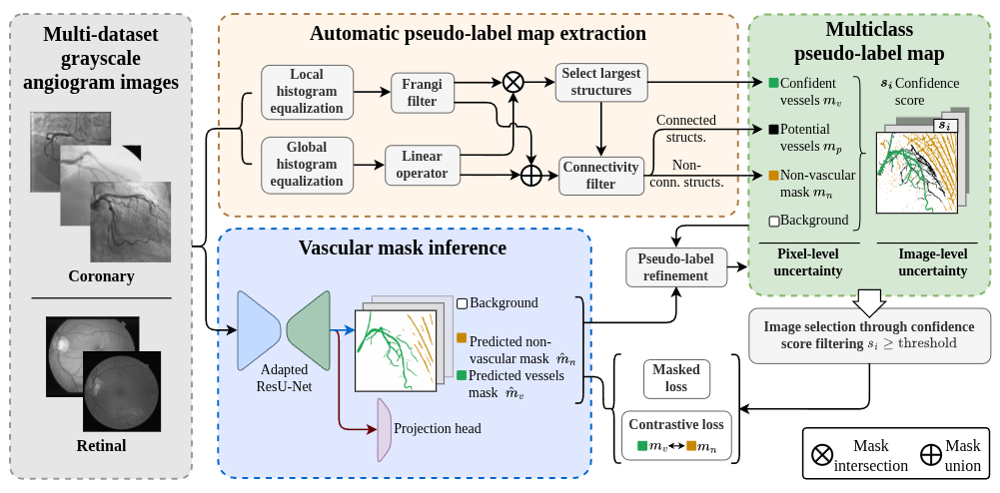

# Confidence-Guided Self-Refinement with Uncertainty-Aware Supervision for Annotation-Free Angiographic Vessel Segmentation


<p align="center">
    
</p>

This repository provides the implementation of a label-free framework for vascular segmentation that explicitly models supervision reliability at both image and pixel levels. The proposed approach combines complementary vessel detectors applied to different intensity transformations with connectivity analysis to identify confident vessel, confident non-vessel, and potential-vessel regions. An image-level confidence score guides the selection of reliable training samples, while uncertain pixels are excluded from hard supervision and progressively reassessed through an iterative confidence-guided refinement process. The segmentation network is trained using a combination of masked Dice, supervised contrastive, and equivariance objectives, enabling it to learn from selectively generated and evolving image-derived supervision without requiring manual annotations during training.

## Dataset organization
Datasets used for training or test must be placed in this particular folder structure:
```
/path/to/datasets/
 ├── 134XCA/
 ├── DRIVE/
 ├── STARE/
 ├── XCAD/
 │   ├── test/
 │   │   ├── images/
 │   │   └── masks/
 │   │
 │   └── training/
 │       ├── images/
 │       ├── plabel_maps/
 │       └── ...
 │
 └── ...
        
```
All images must be in .png format. The script `./aux/main.py` can be helpful to adapt them.

## How to use it

### 1. Pseudo-label extraction algorithms parametrization
It is first required to estimate the parameters for the automatic pseudo-label extraction, which can be used in the following way for retinal datasets:

```bash
cd parameter_setting
python3 frangi_estim_retinal.py --data_path /path/to/datasets/ --ds_name DRIVE --ds_pctg 1
python3 linear_estim_retinal.py --data_path /path/to/datasets/ --ds_name DRIVE --ds_pctg 1 --device 0
cd ..
```

or in this way for coronary datasets:
```bash
cd parameter_setting
python3 frangi_estim_coronary.py --data_path /path/to/datasets/ --ds_name DRIVE --ds_pctg 1
python3 linear_estim_coronary.py --data_path /path/to/datasets/ --ds_name DRIVE --ds_pctg 1 --device 0
cd ..
```

### 2. Pseudo-label extraction

For each training dataset, the pseudo-labels can be automatically extracted running:
```bash
cd plabel_extraction
python3 coronary_plabel_gen.py --data_path /path/to/datasets/ --ds_name DRIVE --device 0
python3 retinal_plabel_gen.py --data_path /path/to/datasets/ --ds_name DRIVE --device 0
cd ..
```

### 3. Iterative training and refinement

The successive training and refinment stages can be sequentially executed running the `planner.py` script after configuring the experiment parameters in it as well as the training and test parameters in `./CGSR/config_train/pretrain_evc_cfg.json`, `./CGSR/config_train/train_evc_cfg.json`, and `./CGSR/config_test/test_evc_cfg.json`

Otherwise, the process can be manually executed running the following scripts:
```bash
cd CGSR
python3 nn_train.py --config config_train/pretrain_evc_cfg.json
python3 nn_test.py --config config_test/test_evc_cfg.json

cd ../plabel_refinement/

python3 coronary_plabel_ref.py --data_path /path/to/datasets/ \
							   --ds_name {DS_NAME} \
							   --pred_path /path/to/training/results/ \
							   --prev_plab_path /path/to/previous/pseudo-label/ \
							   --train_mode "_suffix_for_numbering_the_refinement_stage"

python3 retinal_plabel_ref.py  --data_path /path/to/datasets/ \
							   --ds_name {DS_NAME} \
							   --pred_path /path/to/training/results/ \
							   --prev_plab_path /path/to/previous/pseudo-label/ \
							   --train_mode "_suffix_for_numbering_the_refinement_stage"

cd ../CGSR/
# It is necessary to update the pseudo-label paths in the 
# config files to read the newly refined pseudo-labels
python3 nn_train.py --config config_train/train_evc_cfg.json
python3 nn_test.py --config config_test/test_evc_cfg.json
```